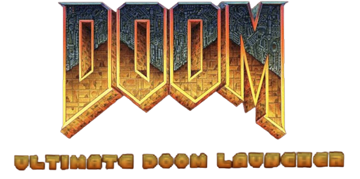
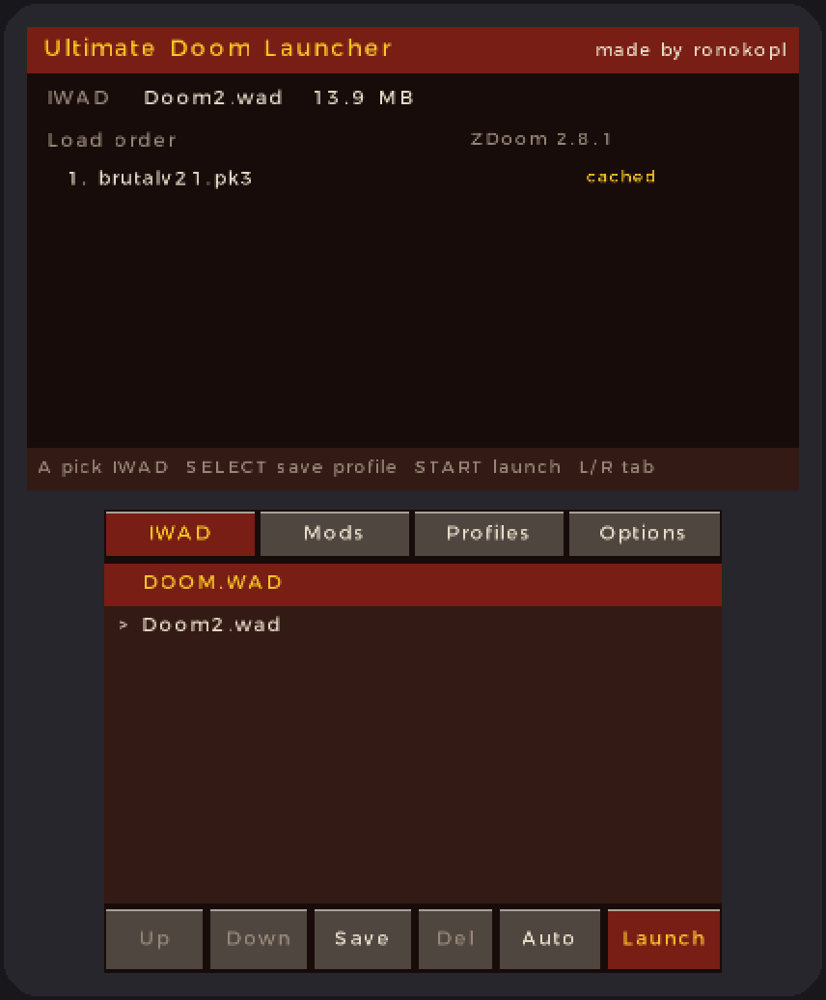
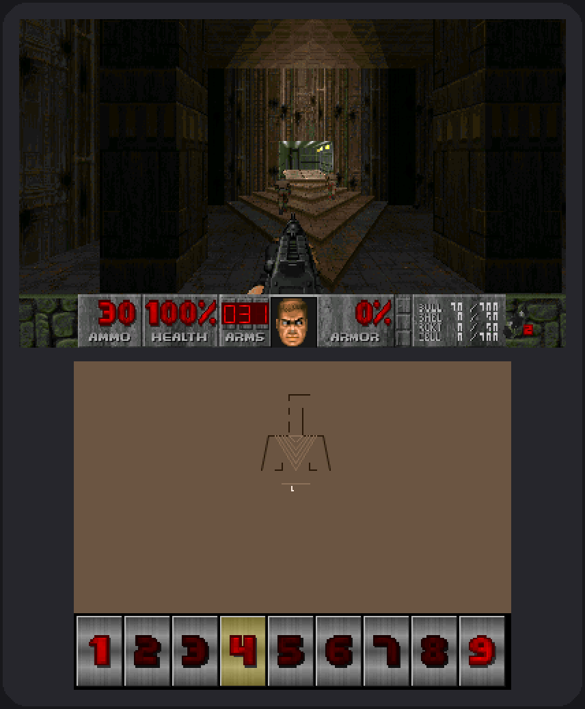
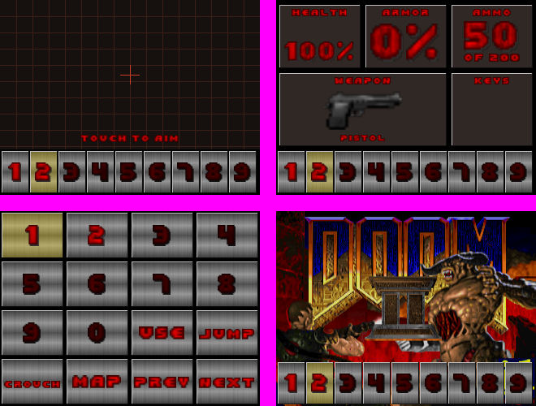

<p align="center">
  
</p>

<p align="center">
  <b>Play Doom and your favorite Doom mods on the Nintendo 3DS.</b><br>
  Pick a game, tick the mods you want, set their order, press START.
</p>

<p align="center">
  <a href="../../releases/latest"><b>⬇ Download the latest version</b></a>
</p>

---

<p align="center">
  
  &nbsp;&nbsp;
  
</p>

## What is it?

**Ultimate Doom Launcher** is a homebrew app for the (New) Nintendo 3DS. It works like the mod launchers you
know from the PC:

- 📂 **Pick your game**: Doom, Doom II, Final Doom, Heretic, Hexen, Freedoom and more.
- 🧩 **Add mods**: `.pk3`, `.wad`, `.zip`, `.pk7`, `.deh` and `.bex` files. Tick them and change their load order.
- 💾 **Save profiles**: keep your favorite setups (for example "Brutal Doom") and start them with one button.
- ⚡ **Faster mods**: the first time you play a mod, the launcher converts it into a 3DS-friendly cache,
  so later loads are much quicker. You can turn this off in the Options tab.
- 🎮 **Made for the 3DS**: Circle Pad and C-Stick controls, optional **gyro aiming**, touch aiming,
  and a useful **bottom screen** (automap, status display, weapon buttons...).
- 🏠 **HOME button and sleep mode work**, also in the middle of a game.

The game itself runs on **ZDoom 2.8.1**, so most classic mods made for ZDoom (DECORATE and ACS) work.

> **No game files are included.** You need your own copy of Doom (or use the free
> [Freedoom](https://freedoom.github.io/) instead).

## What you need

| | |
|---|---|
| **Console** | A **New** Nintendo 3DS, New 3DS XL or New 2DS XL is strongly recommended. Old 3DS models are too slow for most mods. |
| **Custom firmware** | Your 3DS must be able to run homebrew (for example with [Luma3DS](https://3ds.hacks.guide/)). |
| **Installer** | An app that installs `.cia` files, such as **FBI**. |
| **Game files** | Your own Doom IWAD files (`DOOM.WAD`, `DOOM2.WAD`, `PLUTONIA.WAD`, `TNT.WAD`, `HERETIC.WAD`, `HEXEN.WAD`...) or the free `freedoom1.wad` / `freedoom2.wad`. |

## Installation

1. **Download** `doomlauncher3ds.cia` from the [latest release](../../releases/latest).
2. **Copy** it to your 3DS's SD card and **install** it with FBI.
3. **Start** *Ultimate Doom Launcher* from the HOME Menu once. It creates its folders on the SD card for you.
4. **Copy your files** to the SD card:

   ```
   SD card
   └── 3ds
       └── DoomLauncher
           ├── iwads   ← put your game files here (DOOM.WAD, DOOM2.WAD, ...)
           └── mods    ← put your mods here (.pk3, .wad, .zip, ...)
   ```

5. Start the launcher again and have fun! 🎉

> 💡 Prefer the Homebrew Launcher? The release also has a `.3dsx` file. Put it in `SD:/3ds/`.

## Using the launcher

The **top screen** shows what you are about to play. The **bottom screen** has four tabs:

| Tab | What it does |
|---|---|
| **IWAD** | Choose the game. |
| **Mods** | Tick the mods you want. Use **Up** / **Down** to change the load order. |
| **Profiles** | Load or delete a saved setup. |
| **Options** | Turn mod caching on or off, or clear the cache. |

| Button | Action |
|---|---|
| **L / R** | Switch tabs |
| **D-Pad** + **A** | Move and select (the buttons on the bottom screen can be tapped, and the list can be scrolled by dragging) |
| **X / Y** | Move the selected mod up / down in the load order |
| **SELECT** | Save the current setup as a profile |
| **B** | Delete a profile |
| **ZR** | Change the engine (see below) |
| **START** | Launch the game |

> ⏳ **The first launch of a big mod takes a while**, because the launcher builds the cache. A progress bar
> shows how far it is. After that, the mod loads much faster.

## Controls in the game

| Button | Action |
|---|---|
| **Circle Pad** | Move and strafe |
| **C-Stick** | Look around (New 3DS) |
| **ZR** | Shoot |
| **ZL** | Alternate fire |
| **A** | Use / open doors |
| **B** | Crouch (hold) |
| **R** | Jump |
| **L** | Run (hold) |
| **X / Y** | Next / previous weapon |
| **D-Pad** | Inventory (left / right / up) and center view (down) |
| **SELECT** | Automap |
| **START** | Menu |
| **Bottom screen** | Tap the number buttons to pick a weapon |

All buttons can be changed in the game's **Options → Customize Controls** menu.

### 3DS Options

In the game, open **Options → 3DS Options** for console-specific settings:

- **Bottom screen**: Automap, Touch aim pad, Status display, Weapon grid, Title art, or Screen off.
- **Gyro aiming**: aim by moving your console (hold a button, toggle it, or always on), with adjustable speed
  and automatic drift correction.
- **Swap bumpers and triggers**: one switch for mods that fire with L/R instead of ZL/ZR.
- **Screen resolution** and **Render scale**: trade sharpness for speed in heavy mods.

<p align="center">
  <br>
  <i>Some of the bottom screen modes</i>
</p>

## Engines

The **ZR** button in the launcher switches the engine:

- **Auto** (default): the built-in ZDoom 2.8.1 for normal mods. For mods that need ZScript it tries the
  GZDoom add-on.
- **ZDoom**: always the built-in ZDoom 2.8.1, which is fast and runs DECORATE/ACS mods.
- **GZDoom** / **UZDoom**: experimental add-on engines for newer *ZScript* mods. They are separate apps and
  **not part of this release yet**. Without them, mods that need ZScript will not start.

The launcher marks mods that need ZScript with **[ZScript]** in the list, so you know in advance.

## Troubleshooting

<details>
<summary><b>There is no sound</b></summary>

The 3DS sound chip needs a file called `dspfirm.cdc`. The launcher extracts it from your console automatically
on the first start. If that fails, it falls back to a simpler sound mode. Running the "DSP1" homebrew once also
creates the file.
</details>

<details>
<summary><b>A mod says it needs GZDoom / ZScript</b></summary>

Mods written in ZScript need GZDoom 3 or newer. The built-in ZDoom 2.8.1 cannot run them. Look for an older
version of the mod, or wait for the add-on engines.
</details>

<details>
<summary><b>A huge mod runs out of memory or is very slow</b></summary>

The 3DS has very little memory and CPU power compared to a PC. Lower **Render scale** in the 3DS Options, and
avoid very large mod packs.
</details>

<details>
<summary><b>The first start of a mod takes long</b></summary>

That is the mod cache being built (only once per mod). You can turn caching off in the launcher's
**Options** tab, but then every start is slower.
</details>

<details>
<summary><b>Where are my saves and settings?</b></summary>

Everything is in `SD:/3ds/DoomLauncher/`: saves in `save/`, game settings in `zdoom.ini`, launcher profiles in
`profiles.ini`.
</details>

## Building from source

<details>
<summary>For developers</summary>

You need [devkitPro](https://devkitpro.org/) (devkitARM, libctru, citro2d, citro3d, 3ds-libvorbisidec),
Python 3 with `openpyxl` and `Pillow`, plus `makerom` and `bannertool` in a `tools/` folder next to this project.

```
py tools/build3ds.py
```

The output is `build/doomlauncher3ds.3dsx` and `build/doomlauncher3ds.cia`.

The project is set up around spreadsheets in `sheets/`. They describe the controls, menus, launcher layout,
paths and build settings, and the tools in `tools/` turn them into code and check everything before each
build. The 3DS-specific code lives in `platform/3ds/`; the engine is in `engine/zdoom/`.
</details>

## Credits

- Made by **ronokopl**.
- **ZDoom** by Randi Heit (Marisa Heit) and the ZDoom team, the engine this launcher runs.
- **id Software** for Doom.
- **devkitPro**, **libctru**, **citro2d** and **citro3d** for the 3DS toolchain and libraries.
- **makerom** and **bannertool** for building the installable app.

## Legal

This is an unofficial fan project. It is not affiliated with or endorsed by id Software, Bethesda or Nintendo.
DOOM is a trademark of id Software. No game data is included or distributed: you need your own IWAD files.

The engine is ZDoom 2.8.1 and keeps its original licenses; see `engine/zdoom/docs/` (the Doom source license,
the BUILD license and the GPL for parts of the code). This project may only be used non-commercially.
